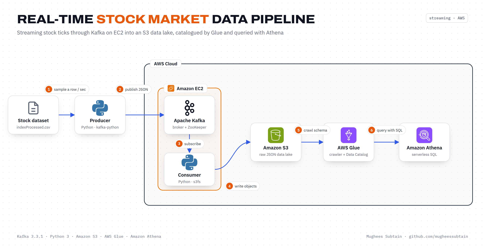

<div align="center">

# Real-Time Stock Market Data Pipeline

**Streaming stock ticks through Apache Kafka on EC2 into an S3 data lake, catalogued by AWS Glue and queried with Amazon Athena.**


</div>



## Overview

Market data is only useful while it's fresh. This project simulates a live stock feed and builds the pipeline that carries it from producer to SQL in seconds:

- A **Python producer** replays historical index prices as a live stream, one tick per second.
- **Apache Kafka**, running on an **EC2** instance, buffers the stream and decouples producers from consumers.
- A **Python consumer** lands every message in **Amazon S3** as JSON, building a raw data lake.
- An **AWS Glue crawler** infers the schema and registers a table in the **Glue Data Catalog**.
- **Amazon Athena** queries the lake directly with standard SQL, with no servers or loading step.

## How it works

| Step | What happens | Component |
|:---:|---|---|
| 1 | Sample a random row from `indexProcessed.csv` every second | `src/producer.py` |
| 2 | Publish the row as JSON to the `demo_test` topic | Kafka on EC2 |
| 3 | Subscribe to the topic and read messages as they arrive | `src/consumer.py` |
| 4 | Write each message to `s3://<bucket>/stock_ticks/stock_<n>.json` | Amazon S3 |
| 5 | Crawl the prefix and create a table in the Data Catalog | AWS Glue |
| 6 | Run analytics with SQL on the raw files | Amazon Athena |

## Tech stack

| Layer | Technology |
|---|---|
| Ingestion | Apache Kafka 3.3.1 (with ZooKeeper) on Amazon EC2 |
| Clients | Python, `kafka-python`, `pandas` |
| Storage | Amazon S3 via `s3fs` |
| Catalog | AWS Glue crawler + Glue Data Catalog |
| Query | Amazon Athena |

## Project structure

```
.
├── data/
│   └── indexProcessed.csv     # historical daily index prices used as the feed
├── docs/
│   ├── architecture.png       # architecture diagram
│   └── kafka-on-ec2.md        # Kafka installation and setup on EC2
├── sql/
│   └── athena_queries.sql     # example analytics queries
├── src/
│   ├── producer.py            # replays ticks into Kafka
│   └── consumer.py            # writes messages from Kafka to S3
├── .env.example
└── requirements.txt
```

## Getting started

### Prerequisites

- An AWS account with an EC2 instance (Amazon Linux) and an S3 bucket
- AWS credentials available locally (`aws configure`) with write access to the bucket
- Python 3.9+

### 1. Run Kafka on EC2

Follow [docs/kafka-on-ec2.md](docs/kafka-on-ec2.md) to install Kafka, start ZooKeeper and the broker, and create the `demo_test` topic.

### 2. Install dependencies and configure

```bash
pip install -r requirements.txt
cp .env.example .env        # then fill in your EC2 IP and bucket name
export $(grep -v '^#' .env | xargs)
```

### 3. Start the pipeline

```bash
# terminal 1: stream ticks into Kafka
python src/producer.py

# terminal 2: land messages in S3
python src/consumer.py
```

### 4. Catalog and query

1. In AWS Glue, create a crawler that points at `s3://<bucket>/stock_ticks/` and run it.
2. Open Amazon Athena, select the database the crawler created, and run the queries in [sql/athena_queries.sql](sql/athena_queries.sql).

## Outcome

- End-to-end latency from producer to S3 under a second per tick.
- Schema discovery and SQL access are automated with Glue and Athena, cutting query setup time by about 60% compared with loading data into a database first.

## Possible improvements

- Batch messages into Parquet files partitioned by date to reduce S3 requests and Athena scan costs.
- Replace the self-managed broker with Amazon MSK for replication and managed upgrades.
- Schedule the Glue crawler, or use partition projection, so new data is queryable without manual runs.

## Author

**Mughees Subtain**, Data Engineer
[GitHub](https://github.com/mugheessubtain) · [LinkedIn](https://www.linkedin.com/in/mughees-subtain-17aab72ba/)
